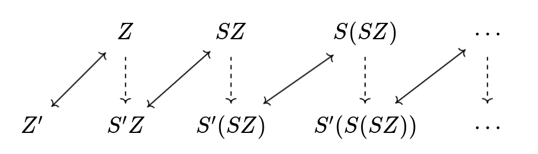
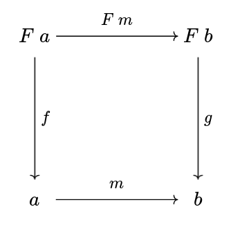
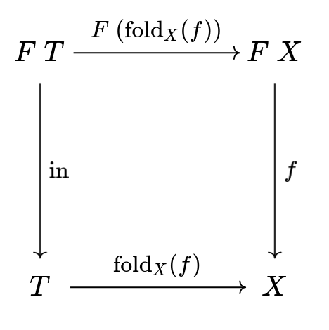
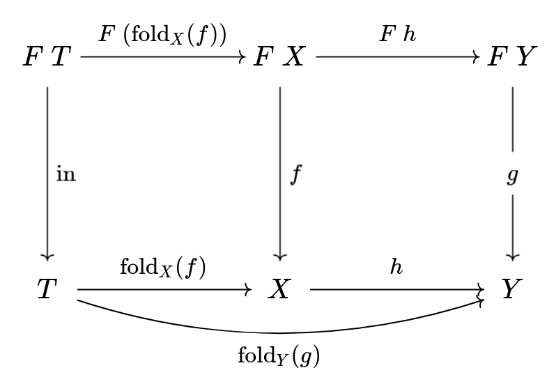
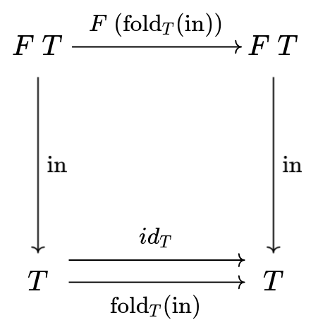
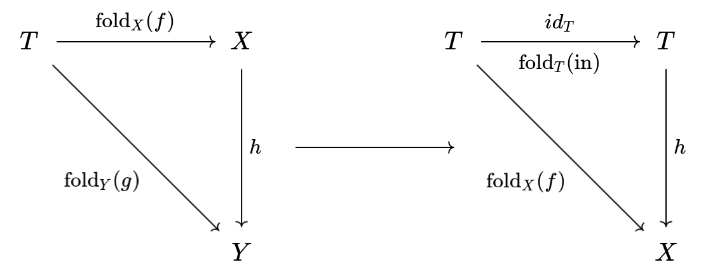
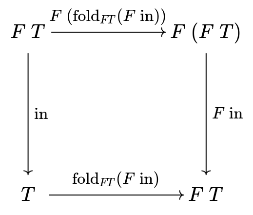
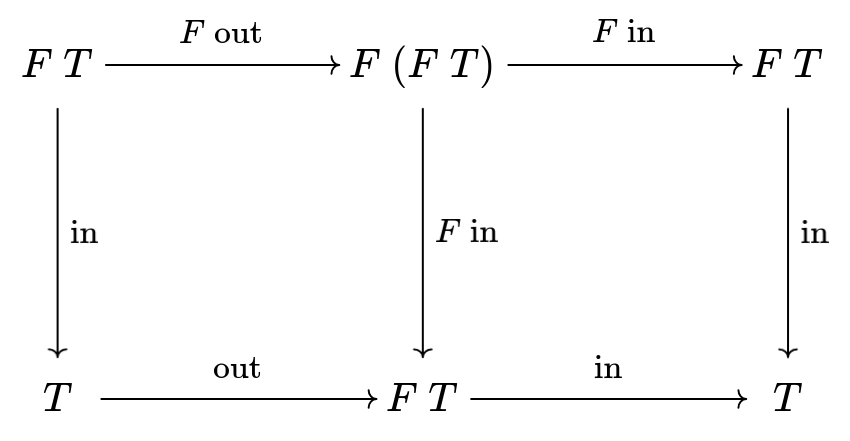
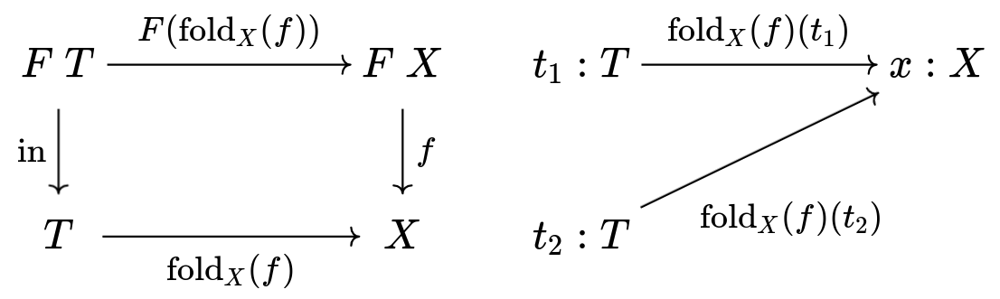
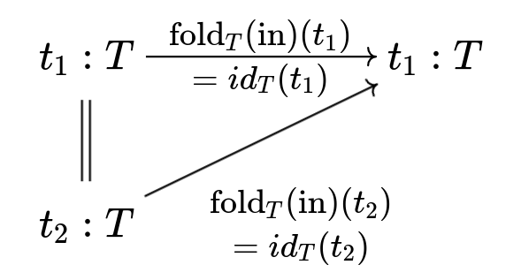

最近被问到了关于ADT的事情呢，于是想写一篇速通关于ADT、递归类型是怎么回事. 它面向了解过如何使用ADT，不过对ADT和递归类型的背后理论感兴趣的人，其他的部分我会尽可能self-contained.

<!--more-->

# 啥是ADT呢？

代数数据类型（Algebraic Data Types）顾名思义就是可以做运算的数据类型. 这里算的数字很简单就是这个数据类型的值的数量.

> 具有类型`T`的值称为`T`的居留元（inhabitant）.

## 1+1=2

- **1**：只有一个值的类型，在Haskell中记作`()`，它有很多名字`Unit`、top $\top$、或者就叫$1$. 在编程语言中，当你没有给函数参数调用它时，其实相当于你给了它一个$()$作为参数：`f()`.
- **加法**：对应和类型（sum types）. 类型`A`和类型`B`的值都是和类型`A + B`的值，不过我们要指定这个值是来自`A`还是`B`. 在Haskell中，这就是`Either A B`，用`Left`和`Right`来区分. 这样，这个和类型的值的数量就是类型`A`和`B`的数量之和.
- **2**：众所周知，$2 = 1+1$. 我们把两个1加起来`data Two = L () | R ()`，就得到了有两个值的类型. 对了，有两个值的类型通常叫`Bool`. 

## 类型同构

这里的等号表示的等价关系其实是说两个类型的值的数量相等，称为**类型同构**$\simeq$. 和集合一样，我们也可以通过定义类型之间的同构函数来证明两个类型是同构的：这两个类型的值一样多. 

例如，我们怎么知道$1+2=2+1$呢？我们可以定义这两个类型之间的同构函数：

```haskell
to   :: Either () Bool -> Either Bool ()
to   (Left ())     = Right ()
to   (Right True)  = Left True
to   (Right False) = Left False

from :: Either Bool () -> Either () Bool
from (Left True)   = Right True
from (Left False)  = Right False
from (Right ())    = Left ()
```

> 当然我们还要验证$to \circ from=from\circ to=id$. 不过这很显然.

这说明类型上的加法是有交换律的.

我们用类型的同构来定义类型间的相等也很好理解. 如果我们有这一对同构函数，那么在任何使用场景，我们总能通过这个同构函数，把一个类型当做相等的另一个类型来使用，例如：

```haskell
-- 已知Two = Bool
to   :: Two -> Bool
from :: Bool -> Two

-- 那么我们总是可以把Two当做Bool用
isEven  :: Int -> Bool
isEven' :: Int -> Two
isEven' = from . isEven
```

## 更多运算

- **乘法**：对应积类型（product types）. 不过更熟悉 的称呼应该是（二）元组，大多数编程语言都有的. 元组`(A, B)`，如果`A`有$a$个值，`B`有$b$个，那这个元组类型就有$A\times B$个.
- $1\times 2=2$：用1乘上2，`((), Bool)`，确实只有两个值的`((), True)`和`((), False)`.
- **幂**：对应函数类型`A -> B`. 同样的，你也可以验证这个类型的值（不同的函数）是否确实是$A^B$个. 
- **0**：是的，我们还需要有0. 你可以猜到的，这是个底下没有值的类型. 称为空类型bottom$\bot$. 

## 类型范畴

这些构造在范畴论中有着一一对应的概念：类型作为对象，类型之间的函数作为态射构成一个范畴. 

> 别害怕！所谓范畴其实就是一堆随便什么东西（称为对象），它们之间有互相指来指去的箭头（称为态射）. 当然，这些箭头有一些好的性质，不喜欢看的可以跳过：
>
> - 每个对象都有个到自己的箭头$id$
> - 收尾相连的两个箭头可以组合成一个新箭头，例如如果有箭头$f:A\to B$，$g:B\to C$，可以组合成新的从$A$到$C$的箭头$g\circ f:A\to C$.
> - $id$箭头复合上别的箭头都等于那个箭头，就是说$id \circ f=f\circ id=f$.
> - 复合运算有结合律$h\circ(g\circ f)=(h\circ g)\circ f$.
>
> 每个类型都有自己到自己的恒等函数，而复合则是函数的复合. 可以验证它确实是一个范畴.

| 类型论 | 范畴论   |
| ------ | -------- |
| 0      | 终结对象 |
| 1      | 初始对象 |
| 和类型 | 余积对象 |
| 积类型 | 积对象   |
| 幂     | 函数对象 |

# 那递归类型呢？

大多数时候我们说ADT都指的是可以递归的，也就是定义类型的时候可以包括自身. 最经典的递归类型例子是自然数. 例如在Haskell中我们可以定义自然数类型：

```Haskell
data Nat = Zero | Succ Nat
```

一个自然数要么是0要么是一个自然数的后继. 这个ADT的定义中`Nat = 1 + Nat`出现了它自身. 我们已经知道了什么是`1`、什么是`+`，可是这种递归的类型到底是什么意思呢？

## 函子的不动点

仔细看`Nat`的定义可以发现，`Succ`的参数的类型就是它自身. 我们把这个自然数类型记作变量$X$，那么这个性质就可以写成：
$$
X=1+X
$$
而我们使用的`Nat`就是这个等式的（一个）解. 更进一步的，我们可以把右边定义为一个类型函数：
$$
F(X)=1+ X
$$
这样，我们的`Nat`就是这个函数的一个不动点$X=F(X)$.

刚刚提到，类型构成一个范畴，我们刚刚引入的类型函数，其实可以看做是这个范畴上的一个自函子.

> 别害怕！在类型范畴的语境下，一个（自）函子$F$的意思是：
>
> - 对于每个类型$A$，都可以作用上$F$得到一个类型$FA$.
> - 对于任意的函数$f:A\to B$，可以作用上$F$得到$F f:FA\to FB$.
> - $F$还要保持恒等函数和函数复合运算，也就是：$F\ id=id$以及$F(g\circ f)=Fg\circ Ff$.
>
> 所以说，$F(X)=1+X$是一个函子，可以自己验证一下.

更一般地，对于其他的递归类型，我们也可以做类似的事情，把定义中递归的地方挖成一个空，这就对应着一个函子，而这个函子的不动点就是我们所说的递归类型了.

> 等一下，你确定$F(X)=X\to \mathrm{Int}$也是函子吗？好吧，把ADT的任意一个地方挖成一个空不总是对应一个函子：例如在函数参数的位置，可以验证一下这确实无法满足函子的定义. 
>
> 事实上，Haskell确实支持定义这样的递归类型：例如`data X = X (X -> Int)`. 这意味着至少Haskell里的递归类型不一定对应一个函子. 不过，有证据表明这种不能表示成函子的递归类型是很坏的，它们会引入无法停机的程序！
>
> 相反的，当我们限制那些可以表示为函子的类型，在下文中我们看到我们甚至可以把它encode在system F里.

## 同构

现在还有最后一个小细节，这里的类型之间的相等其实是刚刚提过的类型同构. 也就是说，当我们定义一个递归类型，其实我们想要的是：一个具体的类型$T$，它对于一个函子$F$（定义的右边部分），存在一对同构函数$T\to FT$和$FT\to T$. 例如，当我们在说自然数类型的时候，其实我们想要的是：

```haskell
-- 一个神秘的类型T
type T = ...

-- 它对于这个函子
data NatF a = Zero' | Succ' a

-- 存在一对同构映射
to   :: T -> NatF T
from :: NatF T -> T
```

当然，我们的Haskell中的定义就是符合这个定义的一个$T$：

```haskell
-- 一个神秘的类型T = Nat
data Nat = Zero | Succ Nat

-- 它对于这个函子
data NatF a = Zero' | Succ' a

-- 存在一对同构映射
to   :: Nat -> NatF Nat
to   Zero      = Zero'
to   (Succ n)  = Succ' n
from :: NatF Nat -> Nat
from Zero'     = Zero
from (Succ' n) = Succ n
```

我们很轻易就可以看出这确实是一对同构函数. 不过我们可以稍微再仔细看看这里到底发生了什么. 

首先`NatF Nat`这个类型是什么呢？我们展开它的定义：

```haskell
NatF Nat = Zero' | Succ' Nat
```

我们发现它就是把原来的`Nat`包在了`Succ'`里，并另外提供一个新的`Zero'`，这正对应着$1+T$. 这就相当于是在原来我们有的自然数的基础上，增加了一个元素. 

那么问题来了，这个新得到的类型`NatF Nat`和原来的`Nat`类型的元素数量一样多吗？答案是肯定的，我们只要像这样错开一个数，就能重新一一对应了：



你可以发现这就是我们刚刚定义的同构函数. 于是，我们证明了我们定义的`Nat`类型确实是满足$T\simeq 1+T$的. 正因为有这个性质，我们在任何时候都可以把`T`当做`1+T`或者把`1+T`当做`T`来用. 在代码中，这意味着我们确实可以无限地展开，这些都是这个类型的值：

```haskell
data Nat = Zero | Succ Nat
         = Zero | Succ Zero | Succ (Succ Nat)
         = Zero | Succ Zero | Succ (Succ Zero) | Succ (Succ (Succ Nat))
         = ...
```

> 是的你发现了，这就是希尔伯特旅馆！

这个`Nat`的定义是Haskell给我们的，不过，我们真的需要它吗？有没有种可能我们不用Haskell提供的这一特性可以免费得到它呢？现在让我们忘记Haskell给我们的递归类型吧，我们从头发明它.

> 《我忘记了如何在Haskell中定义递归类型》

# 从零开始的递归类型

稍等一下，作为准备工作在正式开始之前，先介绍一下F-代数吧！我保证这很快的，如果不想看的话跳过下一节也完全没问题.

> 要加速咯！

## 从F-代数开始

简单的说，我们可以用一个函子来表示一个代数结构，怎么做呢？拿最熟悉的幺半群为例，我们先回忆一下幺半群的定义需要什么：

- 一个集合$m$

- 一个封闭的二元运算$\mu : m \times m \to m$

- 和其中的一个元素（幺元）$\eta : 1 \to m$

  > 还记得ADT的性质吗？$m\simeq m^1$也就是$1\to m$.

我们把需要的这些数据打包成一个表示幺半群的类型，利用ADT的性质可以整理为：
$$
m^{m\times m}\times m^1\simeq m^{m\times m + 1}\simeq m\times m+1\to m
$$
我们可以把左边$m\times m + 1$看做一个函子$F(X)=X\times X+1$应用在类型$m$上，这样一个幺半群可以定义为一个对$(m, F\ m \to m)$. 嗯，这看起来很自然，箭头左边$F\ m$是这个代数需要的一堆运算的打包，而右边这个$m$则表示这些个运算在$m$上是封闭的.

使用不同的函子，我们可以推广到别的代数结构. 更一般的，对于任意一个（自）函子$F$，我们取一个对象$a$和一个态射$F\ a\to a$，这个二元组$(a, F\ a\to a)$称为一个F-代数. 下文中，我们可以简单的把这个态射$F\ a\to a$表示这个代数.

> 是的你发现了，这个定义并没有包括幺半群需要满足的代数性质. 

我们现在使用函子来表示代数了，同样的我们可以考虑代数之间的同态. 还是以幺半群为例，一个从幺半群$A$到幺半群$B$的同态$f$需要满足$f(1_A)=1_B$，$f(x \times_A y)=f(x)\times_B f(y)$. 用我们的形式写写看这个条件：

- 设$f: F\ a \to a,\ g: F\ b\to b$为两个F-代数. 同态$m: a\to b$需要满足$m(f(F\ x))=g(F\ m(x))$.

这对应着这张交换图：



> 函子$F$负责处理这个结构：通过把$m$提升为$F\ m$，原本$a\to b$的函数变成了$(a \times a + 1)\to (b \times b + 1)$的函数，这就是$f(x \times_A y)$是如何变成$f(x)\times_B f(y)$的.

ok了，根据这个定义，如果态射$m:a\to b$满足这个交换图的话，我们称它是从F-代数$f$到$g$的同态. 更进一步可以发现，以F-代数作为对象，F-代数之间的同态作为态射的话，又可以构成一个范畴. 这就是F-代数范畴.

## 递归类型作为F-代数

速速言归正传. 我们刚才提到递归类型对应着一个函子$F$，一个类型$T$以及一对同构$T\to F T$和$FT\to T$. 是的你发现了，这个$FT\to T$的函数就对应着一个F-代数！

> 嗯嗯你说得对，那$T\to FT$呢？别急，我们很快就会讨论这另一个方向.

好吧，这并没有什么，我们有很多很多这样的函数. 例如对于`NatF`来说，我们取`()`类型：

```haskell
foo :: NatF () -> ()
foo _ = ()
```

就定义了一个它的F-代数，但`()`显然不是我们想要的那个递归类型. 怎么从这一堆的F-代数中选出我们的那个递归类型呢？

## 初始F-代数

在一个范畴中，如果其中的一个对象到这个范畴中的任意对象都有**唯一**的态射，则它是**初始对象（initial object）**.

> 初始对象不是一定存在的.

现在我们来看看函子$F$的F-代数范畴的初始对象长什么样吧. 假设我们有这个初始对象$(T, FT\to T)$，首先根据定义，它到任意的F-代数都有一个态射. 在F-代数范畴中一个态射意味着一个同态，也就是说，对于任意的F-代数$f:FX\to X$都有一个同态，记为$\mathrm{fold}_X(f):T\to X$，如下图所示：

> 我们把这个初始对象的态射记为$\mathrm{in}:FT\to T$.



接下来，因为它对任意的F-代数都有这个性质，我们先再考虑另一个F-代数$g:FY\to Y$，并且有同态$h:X\to Y$. 同时，因为$T$的初始性，我们同样有从T到Y的同态$\mathrm{fold}_Y(g):T\to Y$：



我们知道范畴中的箭头是可以复合的，而$T$的初始性又告诉我们，从$T$到$Y$的同态有且只有一个，因此我们有了第一个结论：
$$
h\circ\mathrm{fold}_X(f) = \mathrm{fold}_Y(g)\tag{1}
$$
然后，因为$T$自己也是一个F-代数，我们有：



我们知道任意对象都有到自己的$id$态射，而同时$T$又有唯一的到自己的同态$\mathrm{fold}_T(\mathrm{in})$，因此我们有第二个结论：
$$
\mathrm{fold}_T(\mathrm{in})=id_T \tag{2}
$$
有趣的是，如果一个代数有到任意其他代数的那个$\mathrm{fold}_X$，并且满足$(1)$和$(2)$这两个条件，也可以推出它就是初始代数（推出唯一性）. 首先由$(1)$，我们把其中的$X$换成$T$，$Y$换成$X$（只是为了好看，这个换不换都行啦）：



又因为条件$(2)$，我们知道$\mathrm{fold}_T(\mathrm{in})$其实就是$id_T$. 我们有$h\circ id_T=\mathrm{fold}_T(\mathrm{in})$，而$h\circ id_T=h$. 也就是说，对于任意的代数$X$，这个同态$\mathrm{fold}_T(\mathrm{in}):T\to X$是唯一的，因此$T$确实是初始代数.

## 你说得对，那同构在哪？

更神奇的是，如果$(T,\mathrm{in})$是初始F-代数的话，$\rm in$是个同构！也就是说，我们可以免费得到另一个反方向的箭头$\mathrm{out}:T\to FT$，而且满足$\mathrm{in}\circ\mathrm{out}=\mathrm{out}\circ\mathrm{in}=id$. 怎么做呢？

首先，因为$F$是个函子，我们可以作用在$\mathrm{in}:FT\to T$上得到$F\ \mathrm{in}:F(FT)\to FT$. 我们发现这同样是个以$FT$为对象的F-代数. 因此，结合$T$的初始性，不是我们有从$T$到$FT$的同态嘛，也就是$\mathrm{fold}\_{FT}(F\ \mathrm{in}):T\to FT$. 而且，这个同态是唯一的，因此它就是$\mathrm{out}=\mathrm{fold}_{FT}(F\ \mathrm{in})$. 很神奇吧！



不过你先别急，我们还要验证这是否真的构成同构呢. 现在让我们凝视下面这张有魔力的图：



左边这个方块就是刚刚的图，而右边的方块仔细看发现是废话. 不过很快我们可以发现$\mathrm{in}\circ\mathrm{out}$是个从$T\to T$的同态，而$id_T$也是. 由唯一性我们可以得到$\mathrm{in}\circ\mathrm{out}=id$.

现在我们再看左侧方块，由函子的性质我们有：
$$
\mathrm{out}\circ\mathrm{in}=F\ \mathrm{in}\circ F\ \mathrm{out}=F\ (\mathrm{in}\circ \mathrm{out})=F\ id=id
$$
完成了，现在我们可以很放心的说$\rm in$和$\rm out$确实是一对同构了！

## 最后一块拼图？

回顾一下，我们刚刚证明了对于函子$F$的F-代数，初始代数$(T,\mathrm{in}:FT\to T)$（意味着我们有到其他代数的唯一同态$\mathrm{fold}_{X}(g)$）和免费得到的$\mathrm{out}:T\to FT$构成同构. 这正对应着我们刚才讨论的递归类型的定义：$F$的初始代数就是我们想要的那个不动点$T\simeq FT$. 更进一步的，在这个F-代数范畴，我们将$X\to Y$视为偏序关系$X \sqsubseteq Y$的话，我们的初始代数对应的就是$F$的**最小不动点**. 

现在我们只差最后一步了：我们要不用Haskell的递归类型，在system F中找到这个初始代数$(T,\mathrm{in}:FT\to T)$. 在之前，我们都是以类型范畴为视角来讨论的. 现在为了实现$T$，我们深入进去pointwise地观察$T$的每个值需要满足什么性质：

首先，我们知道$T$到任意一个$X$都有一个$\mathrm{fold}$同态. 它的类型可以很轻松地表示：
$$
\mathrm{fold}: \forall X. (F\ X\to X) \to T \to X
$$
现在我们考虑$t_1:T$，我们应用这个同态会得到一个值$x:X$. 现在我们观察如果有另一个$t_2:T$，它对于应用这个同态都会得到相同的$x:X$会发生什么：



和之前一样，因为我们知道$T$到自己有个特殊的同态$\mathrm{fold}_T(\mathrm{in})=id_T$，于是我们很快就会发现$t_1=t_2$：



反过来说，对于$T$类型的每一个不同的值$t_1$，$t_2$，总存在某个$\mathrm{fold}_X(f)$使得应用上它们会得到不同的值$\mathrm{fold}_X(f)(t_1)\not= \mathrm{fold}_X(f)(t_2)$.

对于每一个$t:T$，我们可以把它对于任意的$\mathrm{fold}$的作用结果用一个函数表示：
$$
\Phi:T \to (\forall X. (F\ X\to X) \to X)\\\\
\Phi = \lambda t.\Lambda X. \lambda f: F\ X\to X. \mathrm{fold}_X\ f\ t
$$
我们刚刚的结论，确保了这个函数是个单射（对不同的$t$，得到的那个函数总是不同的）. 接下来我们只需要证明它还是个满射，我们就能愉快地得到$T \simeq \forall X. (F\ X\to X) \to X$了.

满射，也就是说对于任意$g:\forall X. (F\ X\to X) \to X$，都有$t:T$使得$\Phi(t)=g$. 

首先我们取初始代数作为参数是可以得到$g_T\ \mathrm{in}:T$的. 接下来要证明$\Phi(g_T\ \mathrm{in})=g$成立.

我们左侧展开定义，右侧$\eta$-展开，即证：
$$
\Lambda X. \lambda f: F\ X\to X. \mathrm{fold}_X\ f\ (g_T\ \mathrm{in})=\Lambda X. \lambda f: F\ X\to X.g_X\ f
$$
遗憾的是这个结论在范畴论框架下并不好证，Wadler告诉我们这需要结合system F的parametricity才能得到.

根据parametricity，由$g$的类型，我们可以得到对应的free theorem：

- 对任意函数$a:A \to A'$，都有
  - 对任意$f:FA \to A$，$f':FA' \to A'$，如果$\forall x,x'.\ F\ a\ x=x' \Rightarrow a\ (f\ x)=f'\ x'$
  - 则有$a\ (g_A\ f)=g_{A'}\ f'$成立.

所以我们可以取$a=\mathrm{fold}_X\ f:T\to X$，$f = \mathrm{in}$，$f'=f$. 这样前提就变成了：

- $\forall x,x'.\ F\ (\mathrm{fold_X}\ f)\ x=x' \Rightarrow \mathrm{fold_X}\ f\ (\mathrm{in}\ x)=f\ x'$

这个式子画成交换图的话就是：


是不是很眼熟，这就是我们的同态条件，这个显然已经满足了. 于是我们把它们都代进去，就愉快地得到了结论：
$$
\mathrm{fold}\_X\ f\ (g_T\ \mathrm{in})=g\_{X}\ f
$$
至此我们就证明完毕了，$T \simeq \forall X. (F\ X\to X) \to X$. 也就是说，$\forall X. (F\ X\to X) \to X$就是我们想要的$F$的最小不动点，我们可以把它当做我们的递归类型来使用！

> 如果没有parametricity的话，这个encoding就不是初始F代数.

## 免费的递归类型！

在一番推导后，我们终于重新发明了递归类型. 现在我们来验证一下吧. 还是以自然数为例，现在我们可以给出它们的完整定义了：

```haskell
-- 一个神秘的类型T = forall a. (NatF a -> a) -> a
type MyNat = forall a. (NatF a -> a) -> a

-- 它对于这个函子
data NatF a = Zero' | Succ' a deriving Functor

-- 是它的初始代数
foldMyNat :: (NatF a -> a) -> MyNat -> a
foldMyNat k t = t k

-- 存在一对同构映射
to'   :: MyNat -> NatF MyNat
to'   = foldMyNat (fmap from')
from' :: NatF MyNat -> MyNat
from' s k = k (fmap (foldMyNat k) s)
```

我们可以验证一下它和我们正常定义的自然数类型是不是同构的：

```haskell
data Nat = Zero | Succ Nat
to   :: Nat -> NatF Nat
to   Zero      = Zero'
to   (Succ n)  = Succ' n
from :: NatF Nat -> Nat
from Zero'     = Zero
from (Succ' n) = Succ n

foldNat :: (NatF a -> a) -> Nat -> a
foldNat f Zero = f Zero' 
foldNat f (Succ n) = f (Succ' (foldNat f n))

-- 存在一对同构映射
toNat   :: MyNat -> Nat
toNat   = foldMyNat from
fromNat :: Nat -> MyNat
fromNat = foldNat from'，重新发明了递归类型
```

太好了，我们成功发明了递归类型！

# 总结

回顾一下：我们首先介绍了类型之间的运算是什么，类型同构作为类型之间的等价关系. 然后我们通过把递归类型表示为成一个类型范畴上的自函子$F$的一个不动点. 接着我们引入了F代数的概念，并发现这个不动点对应着F代数范畴中的初始F代数. 由此，我们进一步在System F中找到了这个类型，发现了递归类型的另一种实现方法. 

# 参考

[1] Philip Wadler, "Recursive types for free!", 1990. https://homepages.inf.ed.ac.uk/wadler/papers/free-rectypes/free-rectypes.txt

[2] Philip Wadler, “Theorems for Free!”, 1989. https://dl.acm.org/doi/pdf/10.1145/99370.99404
